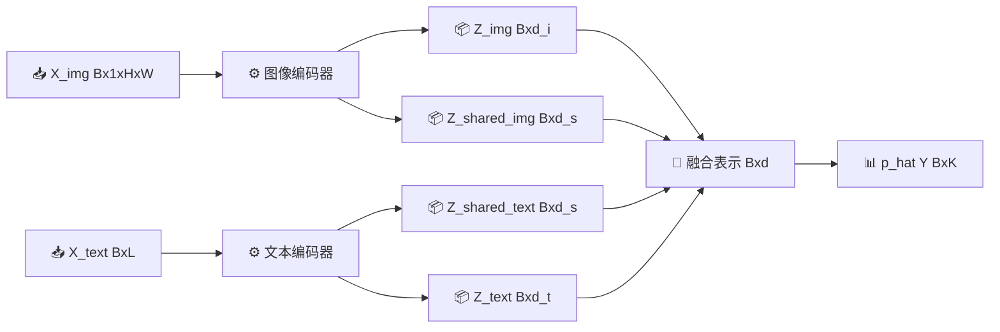

# Day 029｜2026-10-12｜一元导数、泰勒展开与任务充分表示

> 今天是周一，采用 **2 小时核心路线 + 最多 2 小时进阶路线**。先完成核心闭环；只有核心得分达到 80/100，才进入进阶。
>
> 核心问题：导数为什么是局部变化率，有限差分为什么不是越小越好；一个更短的表示 `Z=f(X)` 在什么条件下仍保留预测 `Y` 所需的信息？

实际运行得到：`sin'(0.7)=0.764842187 per rad`；中心差分的最佳扫描点为 `h=1e-5 rad`、绝对误差约 `1.70e-11 per rad`，继续减小 `h` 后误差反而增大。离散表示实验中，完整输入 `X=(S,N)` 与只保留任务信号的 `Z=S` 都有 `I(.;Y)=0.531004 bit/example`、accuracy `0.900`，但固定长度成本从 `2 bit` 降到 `1 bit`；只保留干扰 `N` 时 MI 为 `0`、accuracy 为 `0.500`。

这些结果来自已知合成分布。它们用于研究与教学，不证明因果关系、真实医学表示充分性或临床可靠性。

## 📋 前置知识、环境与提交物

### 前置知识

- 会代入 `sin`、`cos`，知道函数 `y=f(x)` 把一个输入映到一个输出。
- 会读 `X,Y,Z` 作为随机变量，`x,y,z` 作为一次取值；知道概率和为 1。
- 会从仓库根目录运行 Python 命令，并能读 JSON 和 PNG。
- 会用 `git status --short` 区分本次文件与已有未跟踪文件。

补学参考：[MIT 18.01SC Differentiation](https://ocw.mit.edu/courses/18-01sc-single-variable-calculus-fall-2010/pages/1.-differentiation/)只看 Session 1、2、7 的标题、定义和第一个例子，最多 8 分钟；看完能写出差商极限和 `d sin(theta)/d theta=cos(theta)`。时间从核心主线中扣除。

### 环境要求与检查

从仓库根目录运行：

```bash
pwd
git branch --show-current
python3 --version
test -f materials/day029/derivative_representation_lab.py && echo SOURCE_OK
git status --short
```

需要 Python 3.10+、NumPy 1.26–2.x、Matplotlib 3.8–3.x。隔离环境做法参考 [Python `venv`](https://docs.python.org/3/library/venv.html)：只看 Creating virtual environments 和 How venvs work，4 分钟；看完能解释为什么 `/tmp/day029-venv` 不会提交到仓库。

```bash
python3 -m venv /tmp/day029-venv
source /tmp/day029-venv/bin/activate
python3 -m pip install -r materials/day029/requirements.txt
python3 -c "import numpy, matplotlib; print(numpy.__version__, matplotlib.__version__)"
```

若已有满足版本范围的隔离环境，可直接复用。数据、公式和单位契约见 [`materials/day029/README.md`](../materials/day029/README.md#数学与数据契约)。

### 最终提交物

1. `notes/Day029.md`：手算、资料记录、两张图的解释、失败案例、得分与疑问。
2. `/tmp/day029-output/report.json`、`derivative_taylor.png`、`representation_audit.png`：可再生，不提交。
3. `materials/day029/`：完整脚本、21 项测试、依赖和 README。
4. 一张胸片—报告表示接口图：标清输入、输出、shape、随机变量和哪些结论尚未证明。
5. `progress.csv`：日期、实际用时、三项检测、百分制得分、commit 和阻塞问题。

## 🎯 6 个可检测目标

完成后关闭课件，你应能：

1. 用差商极限定义一元导数，并写清输入、输出和单位。
2. 从泰勒展开推到前向差分一阶误差与中心差分二阶误差。
3. 解释步长 `h` 过大时的截断误差和过小时的浮点舍入误差。
4. 写出一阶、二阶泰勒局部模型，并在 `a=0.7 rad` 手算 `sin(1.2)` 的近似。
5. 定义 `X -> Z=f(X)` 与任务 `Y`，用数据处理不等式检查 `I(Z;Y)<=I(X;Y)`。
6. 区分表示充分性、任务准确率、概率校准、鲁棒性和表示成本；不把高 MI 当成因果或医学有效性。

## ⏱️ 时间表

### 2 小时核心路线

| 时间 | 模块 | 任务与就地参考 | 当场产出/成功标志 |
|---:|---|---|---|
| 0–20 分钟 | 主线概念 | 看 [3Blue1Brown Chapter 1](https://www.youtube.com/watch?v=WUvTyaaNkzM) 的 0:00–10:30，再看 [MIT Differentiation](https://ocw.mit.edu/courses/18-01sc-single-variable-calculus-fall-2010/pages/1.-differentiation/) Session 1/7 标题与首例；总计 15 分钟 | 关闭页面写出差商极限、`sin' = cos` 和一个单位例子 |
| 20–45 分钟 | 主线手算 | 按本页[差分推导](#有限差分来自泰勒展开)手推前向/中心公式；用 [NumPy `logspace`](https://numpy.org/doc/stable/reference/generated/numpy.logspace.html)只看签名和第一个例子 3 分钟 | 手算 `h=0.1` 的两种估计；说明中心差分为什么消掉偶次一阶偏差 |
| 45–65 分钟 | 主线实验 | 按 [`README`](../materials/day029/README.md#环境与运行)运行脚本；用 [3Blue1Brown Taylor series](https://www.youtube.com/watch?v=3d6DsjIBzJ4) 0:00–8:24 核对局部多项式直觉 | JSON + 两张 PNG；记录最佳 `h`、一/二阶泰勒误差 |
| 65–90 分钟 | 信息论 | 阅读 [MIT 6.441 Chapter 3](https://ocw.mit.edu/courses/6-441-information-theory-spring-2016/resources/mit6_441s16_chapter_3/) 的 sufficient statistic 定义、data processing 小节，最多 12 分钟；再完成离散手算 | 写出 `Y-X-Z`、DPI、充分性等号条件与 `0.531004 bit` |
| 90–105 分钟 | 跨线整合 | 看 [CMU MMML Schedule](https://cmu-multicomp-lab.github.io/mmml-course/fall2022/schedule/) 的 Lecture 3.2/4.1 topics，5 分钟；画本页胸片—报告接口图的手写版 | 每个箭头写输入/输出；至少标一个模态特异表示和一个共享表示 |
| 105–120 分钟 | 检测与提交 | 先独立答[问题与任务](#问题动手任务与迁移题)，再跑测试；按 [Pro Git 2.2](https://git-scm.com/book/en/v2/Git-Basics-Recording-Changes-to-the-Repository)只看 status/diff/staging 3 分钟 | 21/21 tests；百分制至少 80；提交范围只含 Day 029 |

所有阅读时间都已计入表内。120 分钟到时先完成日志和提交，不额外打开新资料。

### 最多 2 小时进阶路线

| 追加时间 | 任务与就地参考 | 产出/验收 |
|---:|---|---|
| +0–30 分钟 | 看 [MIT 18.01SC Taylor unit](https://www.ocw.mit.edu/courses/18-01sc-single-variable-calculus-fall-2010/pages/unit-5-exploring-the-infinite/) 的 Session 98/99 页面说明与首题，最多 15 分钟；把 `sin` 二阶扩成三阶 | 写三阶式与余项阶数；在同一目标点比较误差 |
| +30–60 分钟 | 只改一个因素：把 `--x0` 改为 `1.0`，其余配置不变；参考 [NumPy `logspace`](https://numpy.org/doc/stable/reference/generated/numpy.logspace.html) 核对扫描点 | 新 JSON；解释最佳 `h` 是否相同，以及为何不能把平台相关最优点当常数 |
| +60–90 分钟 | 读 [Information Bottleneck 原论文](https://arxiv.org/abs/physics/0004057) 的摘要、问题定义和目标式，不通读全文，最多 15 分钟 | 用自己的话区分“充分表示”“短表示”“信息瓶颈优化目标” |
| +90–120 分钟 | 读 [CMU Lecture 3.2/4.1](https://cmu-multicomp-lab.github.io/mmml-course/fall2022/schedule/) 的 slides/video 入口与 topics，最多 10 分钟；扩展接口图为 early/late fusion 对照 | 对每种融合写一个普通监督基线、一个成本和一个失败条件 |

进阶路线不要求训练神经网络，也不要求估计连续变量真实 MI。

## 🧮 概念一：导数是带单位的局部线性系数

### 定义、符号与 shape

对标量函数 `f:R->R`，在点 `x` 的导数是：

```text
f'(x) = lim_{h->0} [f(x+h)-f(x)]/h
```

- 输入 `x`、步长 `h` 都是标量，shape `()`。
- 若 `x` 的单位是 `s`、`f(x)` 的单位是 `m`，则 `f'(x)` 的单位是 `m/s`。
- 本课 `theta` 用 rad，`sin(theta)` 无量纲，因此导数记作 `per rad`。
- 导数存在要求差商从左右逼近同一有限值；`f(x)=|x|` 在 `x=0` 左右斜率不同，不可导。

直觉不是“除以一个很小的数”，而是：在足够小的邻域，函数增量可被直线预测：

```text
f(x+delta) = f(x) + f'(x) delta + smaller terms
```

参考：[MIT Differentiation](https://ocw.mit.edu/courses/18-01sc-single-variable-calculus-fall-2010/pages/1.-differentiation/)只看 Session 1–3 的定义/率解释，6 分钟；看完能给导数写单位，而不是只背符号。

### 链式法则

若 `y=f(u)`、`u=g(x)`，则：

```text
dy/dx = (df/du)(dg/dx)
```

例：`y=sin(2t)`，`u=2t`，所以 `dy/dt=cos(u)*2=2cos(2t)`。单位也相乘：`dy/du` 乘 `du/dt` 后得到 `dy/dt`。

常见错误：把 `d sin(2t)/dt` 写成 `cos(2t)`，漏掉内部函数的导数 `2`。卡住后回看 [MIT Differentiation Session 11: Chain Rule](https://ocw.mit.edu/courses/18-01sc-single-variable-calculus-fall-2010/pages/1.-differentiation/)；只做第一个例子，5 分钟。

## 🔬 概念二：有限差分来自泰勒展开

### 泰勒局部模型

若 `f` 在中心 `a` 附近足够光滑：

```text
f(a+delta)
  = f(a) + f'(a) delta + f''(a) delta^2/2 + O(delta^3)
```

`O(delta^3)` 表示当 `delta` 变小时，余项的量级不超过某个常数乘 `|delta|^3`；它不是“余项等于 0”。一阶模型保留常数和斜率，二阶模型再加入曲率。

对 `f(theta)=sin(theta)`、`a=0.7 rad`、目标 `theta=1.2 rad`，`delta=0.5 rad`：

```text
exact  = sin(1.2)                                     = 0.932039
T1     = sin(0.7) + cos(0.7)*0.5                     = 1.026639
T2     = T1 - sin(0.7)*0.5^2/2                       = 0.946112
|T1-exact| = 0.094600
|T2-exact| = 0.014072
```

二阶在这个点更好，但“阶数更高永远更好”不成立：展开中心太远、函数不够光滑或浮点计算不稳时，增加项未必有用。

参考：[3Blue1Brown Taylor series](https://www.youtube.com/watch?v=3d6DsjIBzJ4)只看 0:00–8:24 的 `cos(x)` 逐项匹配直觉，8 分钟；看完能说出每一项在中心匹配哪一阶导数。

### 有限差分来自泰勒展开

把 `delta=h` 代入：

```text
f(x+h)=f(x)+f'(x)h+f''(x)h^2/2+O(h^3)
```

移项并除以 `h`：

```text
[f(x+h)-f(x)]/h = f'(x) + f''(x)h/2 + O(h^2)
```

所以前向差分的主截断误差正比于 `h`。再分别写 `f(x+h)` 与 `f(x-h)` 并相减，偶次项抵消：

```text
[f(x+h)-f(x-h)]/(2h) = f'(x) + f'''(x)h^2/6 + O(h^4)
```

中心差分的主截断误差正比于 `h^2`。这解释了中等 `h` 时中心差分通常更准，却不说明 `h` 应无限小。

### 最小手算

取 `x=0.7 rad,h=0.1 rad`：

```text
exact cos(0.7) = 0.764842187 per rad
forward        = [sin(0.8)-sin(0.7)]/0.1 = 0.731384037 per rad
central        = [sin(0.8)-sin(0.6)]/0.2 = 0.763568088 per rad
```

中心差分误差约 `0.00127410`，小于前向差分约 `0.03345815`。但扫描到 `h=1e-14` 时，相近浮点数相减丢失有效数字，误差会回升，形成 U 形曲线。

参考：[NumPy `logspace`](https://numpy.org/doc/stable/reference/generated/numpy.logspace.html)只看 `start,stop,num,base` 和第一个例子，3 分钟；看完能解释脚本怎样得到 `1e-1,...,1e-14`，而不是把 `h` 当线性等间距。

## 🧠 概念三：表示、数据处理不等式与充分性

### 先定义随机变量

本课精确枚举以下合成分布：

```text
S ~ Bernoulli(0.5)                 # 任务信号
N ~ Bernoulli(0.5), N independent S # 干扰
X = (S,N)                          # 4 个状态
E ~ Bernoulli(0.1)                 # 标签噪声
Y = S xor E                        # 二分类标签
Z = f(X)                           # 确定性编码表示
```

`X,Y,Z` 是随机变量；每个样本的 `x=(s,n)`、`y`、`z` 是取值。信息量单位是 `bit/example`。固定长度状态成本暂定义为 `log2(|Z|) bit`，这是课堂代理，不是神经网络的真实存储或传输成本。

### 数据处理不等式

若 `Z` 只由 `X` 计算，构成 `Y-X-Z` 马尔可夫链，则：

```text
I(Z;Y) <= I(X;Y)
```

后处理不能凭空增加关于 `Y` 的信息。它可以保留，也可以丢失；有限样本估计误差可能让数值暂时违反不等式，所以真实实验要报告估计器和不确定性。

本例：

```text
H_b(0.1) = -0.1 log2(0.1)-0.9 log2(0.9) = 0.468996 bit
I(X;Y) = 1-H_b(0.1) = 0.531004 bit
```

参考：[MIT 6.441 Chapter 3](https://ocw.mit.edu/courses/6-441-information-theory-spring-2016/resources/mit6_441s16_chapter_3/)只看 sufficient statistic definition、data-processing 与等号讨论，12 分钟；看完能解释“知道 `Z` 后是否还能忘掉 `X`”。

### 任务充分表示

对本课任务，若：

```text
p(Y|X) = p(Y|Z)
```

则 `Z` 对预测 `Y` 保留了 `X` 的全部相关信息；在本离散确定性例子中也表现为 `I(Z;Y)=I(X;Y)`。这不等于 `Z` 能重建 `X`，更不等于 `Z` 对别的任务也充分。

| 表示 | 状态/固定成本 | `I(Z;Y)` | accuracy | NLL | Brier | 校准误差 | 解释 |
|---|---:|---:|---:|---:|---:|---:|---|
| `full_x=(S,N)` | 4 / 2 bit | 0.531004 bit | 0.900 | 0.325083 nat | 0.090 | 0 | 完整但含无关干扰 |
| `signal_z=S` | 2 / 1 bit | 0.531004 bit | 0.900 | 0.325083 nat | 0.090 | 0 | 对 `Y` 充分且更短 |
| `nuisance_z=N` | 2 / 1 bit | 0 | 0.500 | 0.693147 nat | 0.250 | 0 | 校准但无判别力 |
| `constant_z` | 1 / 0 bit | 0 | 0.500 | 0.693147 nat | 0.250 | 0 | 多数/先验概率基线 |

“校准误差为 0”并不等于好模型：恒报 `0.5` 在平衡总体上可以完美校准，却没有判别能力。把 `signal_z` 的预测从真实 `0.9/0.1` 改成过度自信 `0.99/0.01` 后，accuracy 仍是 `0.900`，但 NLL 变为 `0.469562 nat`、Brier `0.098`、校准误差 `0.090`。

当测试标签翻转率从 `0.1` 变为 `0.3`，却冻结训练概率时，accuracy 降到 `0.700`、NLL 升到 `0.764528 nat`、Brier `0.250`、校准误差 `0.200`。校准参数只能在验证集拟合，不能在测试集看到结果后重调。

## 🔗 概念四：胸片—报告表示接口图

以下只是研究设计接口，不代表模型已经学到病理机制。`X_img` 是胸片张量，`X_text` 是报告 token；`Y` 是研究标签。所有患者必须按患者级划分训练、验证、测试。



| 对象 | shape/单位 | 含义 | 必须核对 |
|---|---|---|---|
| `X_img` | `(B,1,H,W)`，归一化强度 | 胸片输入 | 视图、设备、患者泄漏、预处理 |
| `X_text` | `(B,L)` token id | 报告文本 | 截断、模板、标签泄漏、去标识化 |
| `Z_img,Z_text` | `(B,d_i)/(B,d_t)` | 候选模态特异表示 | 消融后是否真有独有价值 |
| `Z_shared_*` | `(B,d_s)` | 候选共享空间 | 对齐不等于语义或因果一致 |
| `p_hat(Y)` | `(B,K)`，概率 | K 类预测分布 | 判别、NLL/Brier、校准、外部鲁棒性 |

普通基线必须保留：只用胸片、只用报告、简单拼接/平均融合。若未来引入缺失报告，必须再定义缺失指示 `R`，区分训练/测试/现实缺失，讨论 MCAR/MAR/MNAR，并按模态子集报告样本量、任务性能和校准；不能用“生成的报告像真的”代替任务可靠性。

参考：[CMU MMML Schedule](https://cmu-multicomp-lab.github.io/mmml-course/fall2022/schedule/)只看 Lecture 3.2 的 cross-modal interactions/fusion 与 Lecture 4.1 的 coordinated representations/fission，8 分钟；看完能区分“共享”“模态特异”和“任务输出”三类接口。

## 🛠️ 逐步实践与小项目

### 实践 A：运行完整实验

```bash
source /tmp/day029-venv/bin/activate
MPLCONFIGDIR=/tmp/day029-mpl \
python3 materials/day029/derivative_representation_lab.py \
  --output-dir /tmp/day029-output
```

预期关键输出：

```text
sin_x0=0.700 exact_derivative=0.764842187_per_rad
best_forward=h:1.0e-08_rad,error:2.298e-09_per_rad
best_central=h:1.0e-05_rad,error:1.702e-11_per_rad
taylor_at_1.2_rad=first_error:0.094600,second_error:0.014072
signal_z=I:0.531004_bit,acc:0.900,nll:0.325083_nat,brier:0.090,ece:0.000,cost:1.0_bit
nuisance_z=I:0.000000_bit,acc:0.500,nll:0.693147_nat,brier:0.250,ece:0.000,cost:1.0_bit
shift_epsilon_0.3=acc:0.700,nll:0.764528_nat,brier:0.250,ece:0.200
SUCCESS
```

不同平台的最佳 `h` 可能相差一个扫描点；以 U 形趋势、公式和测试为准，不硬编码平台数值。检查产物：

```bash
python3 -m json.tool /tmp/day029-output/report.json | sed -n '1,260p'
test -s /tmp/day029-output/derivative_taylor.png && echo DERIVATIVE_OK
test -s /tmp/day029-output/representation_audit.png && echo REPRESENTATION_OK
```

参考：[NumPy `logspace`](https://numpy.org/doc/stable/reference/generated/numpy.logspace.html)核对扫描输入；[Matplotlib `savefig`](https://matplotlib.org/stable/api/_as_gen/matplotlib.pyplot.savefig.html)只看 `fname,dpi`，2 分钟；看完能解释 PNG 为何是可再生产物而不是手工截图。

### 实践 B：读图与制造失败

对 `derivative_taylor.png` 写四句，每句包含一个数值：

1. `h` 从 `1e-1` 缩小时，截断误差先下降。
2. 中心差分在中等 `h` 下比前向差分更准，因为主误差为 `O(h^2)`。
3. `h` 太小时舍入误差上升，所以“越小越好”失败。
4. 二阶泰勒在 `1.2 rad` 比一阶更准，但仍不是精确函数。

然后运行单因素变化：

```bash
MPLCONFIGDIR=/tmp/day029-mpl \
python3 materials/day029/derivative_representation_lab.py \
  --x0 1.0 --output-dir /tmp/day029-x1
```

只比较最佳 `h`、最小误差和 Taylor 图；不要同时改 `epsilon`。参考 [`README`](../materials/day029/README.md#边界)；看完能区分数学截断阶数与平台浮点表现。

### 实践 C：测试与可复现性

```bash
MPLCONFIGDIR=/tmp/day029-mpl \
python3 -m unittest materials.day029.test_day029 -v
python3 -m compileall -q materials/day029
python3 -m json.tool /tmp/day029-output/report.json >/dev/null
git diff --check
```

成功标志：21/21 tests、compileall、JSON、两张图和 diff check 全通过。测试框架参考 [Python `unittest`](https://docs.python.org/3/library/unittest.html)：只看 Basic example 的 `assertEqual/assertRaises`，4 分钟；看完能指出至少一个正常路径断言和一个失败路径断言。

### 小项目：任务充分表示证据卡

**输入：** `report.json` 的 `full_x/signal_z/nuisance_z/constant_z/signal_overconfident`，两张 PNG，以及胸片—报告接口图。

**步骤：**

1. 在 `notes/Day029.md` 抄写随机变量定义和单位，不抄结论。
2. 手算 `1-H_b(0.1)`，与 JSON 的 `information_x_y_bits` 比较，误差应小于 `1e-12 bit`。
3. 用表格比较五个模型的 MI、accuracy、NLL、Brier、校准误差和成本。
4. 写一条成功证据：`signal_z` 在更低成本下保留本任务所需信息。
5. 写一条失败证据：过度自信或测试噪声变化时，accuracy 不能代表概率可靠性。
6. 把胸片—报告接口图中的每个 `Z` 对应到“要验证什么”，不得直接标为“充分”。

**检查点：** 第 2 步公式一致；第 3 步不能只留 MI；第 5 步至少写一个 NLL/Brier/ECE 数值；第 6 步必须写患者级划分和普通单模态基线。

**输出：** 一页证据卡，包含“结论、证据、未证明、下一步”四栏。

**验收：** 能在 90 秒内解释为什么 `signal_z` 是本合成任务的充分表示，以及为什么这不能外推到真实医学模型。概念参考 [MIT 6.441 Chapter 3](https://ocw.mit.edu/courses/6-441-information-theory-spring-2016/resources/mit6_441s16_chapter_3/)；多模态接口参考 [CMU MMML](https://cmu-multicomp-lab.github.io/mmml-course/fall2022/schedule/)。

## ⚠️ 常见错误与报错处理

1. **把 `h` 设得越小越好**：截断误差下降，但相减舍入误差上升；必须画全扫描曲线。
2. **角度混用 degree 与 rad**：Python `sin/cos` 使用 rad；输入若是 degree，先明确转换。
3. **把泰勒多项式当全局模型**：它是展开中心附近的局部近似；同时报告 `delta`。
4. **中心差分忘记分母 `2h`**：会得到约两倍错误结果。
5. **在不可导点做梯度检查**：`abs(0)` 没有唯一导数；先检查函数光滑条件。
6. **把低维等同于充分**：维度降低只说明表示更短；还要比较 `p(Y|X)` 与 `p(Y|Z)` 或任务证据。
7. **把 `I(Z;Y)` 高写成因果**：MI 是依赖证据，不给因果方向，也可能来自身份、设备或文本模板泄漏。
8. **只报 accuracy**：过度自信模型 accuracy 不变，但 NLL/Brier/校准更差。
9. **在测试集调概率或阈值**：校准参数只能在验证集拟合，测试集只做最终评估。
10. **把离散精确 MI 当真实神经网络 MI**：本课 PMF 已知；连续确定性表示的 MI 有额外技术问题。
11. **把共享表示当语义证明**：相同 shape 或高对齐分数不证明病理语义相同。
12. **Matplotlib 缓存不可写**：设置 `MPLCONFIGDIR=/tmp/day029-mpl`。
13. **`ModuleNotFoundError`**：确认已激活环境，并执行 `python3 -m pip install -r materials/day029/requirements.txt`。

## ❓ 问题、动手任务与迁移题

> 所有题先独立作答；卡住 2 分钟后再点参考。参考只定位概念，不直接泄露本题答案。

1. 用一句话解释 `f'(x)` 的输入、输出和单位。卡住后看 [MIT Session 1–3](https://ocw.mit.edu/courses/18-01sc-single-variable-calculus-fall-2010/pages/1.-differentiation/)。
2. 为什么前向差分是 `O(h)`，中心差分是 `O(h^2)`？卡住后看本页[有限差分来自泰勒展开](#有限差分来自泰勒展开)。
3. 若 `h` 从 `1e-5` 降到 `1e-14`，为什么中心差分误差可能变大？卡住后看 [`README` 导数契约](../materials/day029/README.md#导数与泰勒)。
4. 对 `sin` 在 `a=0.7` 的二阶泰勒式，二次项为什么是负号？卡住后看 [3Blue1Brown Taylor](https://www.youtube.com/watch?v=3d6DsjIBzJ4) 14:25 附近，再核对 `sin''=-sin`。
5. 写出本课 `X,Z,Y` 的定义和 DPI；`signal_z` 为什么取等号？卡住后看 [MIT 6.441 Chapter 3](https://ocw.mit.edu/courses/6-441-information-theory-spring-2016/resources/mit6_441s16_chapter_3/)。
6. `constant_z` 的校准误差为 0，为什么它仍是差模型？卡住后对照本页[任务充分表示](#任务充分表示)的 accuracy/NLL/Brier。
7. accuracy 相同的 `signal_z` 与 `signal_overconfident`，哪个概率预测更好？至少用两个指标回答。卡住后读 [`README` 预期结果](../materials/day029/README.md#预期关键结果)。
8. **动手任务：** 把 `--x0` 改成 `1.0` 重跑，只比较差分曲线；写出一个不变规律和一个改变的数值。参考 [NumPy `logspace`](https://numpy.org/doc/stable/reference/generated/numpy.logspace.html)，先独立运行后再核对参数。
9. **迁移题：** 研究胸片 `X_img` 与报告 `X_text` 预测 `Y`，部分患者缺报告。定义缺失指示 `R`，列出最低基线、数据划分、分层指标和不能宣称的结论。卡住后看 [`INFORMATION_THEORY_SCOPE.md`](../INFORMATION_THEORY_SCOPE.md#3-非完备多模态的最低实验协议)与 [CMU MMML](https://cmu-multicomp-lab.github.io/mmml-course/fall2022/schedule/)。

<details>
<summary>折叠答案：完成独立作答后再展开</summary>

1. 导数输入是位置/时间等标量点，输出是该点局部变化率；单位是输出单位除以输入单位。
2. 前向式保留 `f''h/2` 主误差；中心相减消掉偶次项，除以 `2h` 后主误差来自 `f'''h^2/6`。
3. 极小 `h` 让 `f(x+h)` 与 `f(x-h)` 太接近，相减丢失有效数字，再除以小数会放大舍入误差。
4. `sin''(a)=-sin(a)`，二阶项为 `f''(a)delta^2/2=-sin(a)delta^2/2`。
5. `X=(S,N)`、`Z=f(X)`、`Y=S xor E`，有 `I(Z;Y)<=I(X;Y)`；`Z=S` 后 `p(Y|X)=p(Y|S)`，因此保留本任务相关信息。
6. 恒报 `0.5` 与总体频率一致，所以可校准；但不能区分样本，accuracy 只有 `0.5`，NLL/Brier 也差。判别和校准是不同维度。
7. `signal_z` 更好：accuracy 都为 `0.9`，但它的 NLL `0.325083<0.469562`、Brier `0.090<0.098`、校准误差 `0<0.090`。
8. 合格答案必须来自自己的运行；规律应包括“中等 `h` 最好而非越小越好”，改变项可为最佳扫描点或最小误差。
9. `X=(X_img,X_text)`、`Y` 为研究标签、`R_text=1` 表示报告可用。按患者划分训练/验证/测试；区分训练、测试和现实缺失并讨论 MCAR/MAR/MNAR。比较稳定单模态、简单填充+mask、可用模态集合池化/融合；按 `{img}`, `{text}`, `{img,text}` 子集报告样本量、AUROC/AUPRC、NLL/Brier 与校准。不能因补全文本流畅、高 MI 或共享表示接近而宣称诊断可靠、因果或隐私保证。

</details>

---

## 📏 100 分量表与补学方案

| 项目 | 分值 | 满分证据 |
|---|---:|---|
| 导数定义、shape、单位 | 10 | 差商极限正确；能给 `m/s` 或 `per rad` 例子 |
| 差分推导与手算 | 15 | 推出 `O(h)`/`O(h^2)`；`h=0.1` 手算正确 |
| 泰勒局部模型 | 15 | 一/二阶式、中心、`delta`、误差与限制齐全 |
| 可运行实验 | 15 | JSON、两图、关键输出与单位齐全 |
| 表示/DPI/充分性 | 15 | 随机变量、马尔可夫链、等号条件和手算 MI 正确 |
| 普通与概率基线 | 10 | accuracy、NLL、Brier、校准、成本至少五项同报 |
| 鲁棒性与边界 | 10 | 解释测试噪声变化；不越界到因果/医学有效性 |
| 测试与提交卫生 | 10 | 21/21 tests、diff check、日志和限定提交范围 |
| **总分** | **100** | **80 分合格** |

### 低于 80 分时只补最低项

- **导数/差分低于 20/25：** 回看 [MIT Differentiation](https://ocw.mit.edu/courses/18-01sc-single-variable-calculus-fall-2010/pages/1.-differentiation/) Session 1/7，并重新手算 `h=0.1`，限 20 分钟；看完能解释分母为何是 `2h`。
- **泰勒低于 12/15：** 回看 [3Blue1Brown Taylor](https://www.youtube.com/watch?v=3d6DsjIBzJ4) 0:00–8:24，关闭视频重写二阶式，限 15 分钟；看完能标出中心与 `delta`。
- **DPI/充分性低于 12/15：** 重读 [MIT Chapter 3](https://ocw.mit.edu/courses/6-441-information-theory-spring-2016/resources/mit6_441s16_chapter_3/) 的定义与等号，重做四表示表，限 25 分钟；看完能说明低维不等于充分。
- **概率可靠性低于 16/20：** 对照 [`README`](../materials/day029/README.md#预期关键结果)重写过度自信与 shift 两个失败案例，限 20 分钟；看完能区分判别、校准和鲁棒性。
- **复现低于 8/10：** 按 [Python `venv`](https://docs.python.org/3/library/venv.html) 和 [`README`](../materials/day029/README.md#环境与运行)从空 `/tmp` 环境重跑，限 25 分钟；成功标志是 `SUCCESS` 与 21/21 tests。

补学后重做对应题，记录第一次错误、修正和第二次得分；未达到 80 分不新增 Day 030 内容。

## 📚 今日资料

| 资料 | 类型 | 今天只看什么 | 为什么今天需要 | 建议用时 | 要求 | 看完必须能做什么 |
|---|---|---|---|---:|---|---|
| [3Blue1Brown Chapter 1](https://www.youtube.com/watch?v=WUvTyaaNkzM) | 官方可视化视频 | 0:00–10:30 | 建立导数是局部变化率的直觉 | 10 分钟 | 必读 | 不看公式先说清局部线性 |
| [MIT 18.01SC Differentiation](https://ocw.mit.edu/courses/18-01sc-single-variable-calculus-fall-2010/pages/1.-differentiation/) | 官方公开课 | Session 1、7、11 的定义与首例 | 核对差商、`sin/cos` 导数、链式法则 | 10 分钟 | 必读 | 写定义、单位和链式法则 |
| [3Blue1Brown Taylor series](https://www.youtube.com/watch?v=3d6DsjIBzJ4) | 官方可视化视频 | 0:00–8:24；进阶看 14:25 | 理解逐阶匹配与局部逼近 | 8 分钟 | 必读 | 写 `sin` 二阶局部模型 |
| [NumPy `logspace`](https://numpy.org/doc/stable/reference/generated/numpy.logspace.html) | 官方 API | 签名、Parameters、首例 | 可复现扫描 `h` 的数量级 | 3 分钟 | 必读 | 生成 `1e-1...1e-14` |
| [MIT 6.441 Chapter 3](https://ocw.mit.edu/courses/6-441-information-theory-spring-2016/resources/mit6_441s16_chapter_3/) | 官方讲义 | sufficient statistic 与 data processing | 定义充分表示和 DPI 边界 | 12 分钟 | 必读 | 写等号条件与未证明内容 |
| [Information Bottleneck](https://arxiv.org/abs/physics/0004057) | 原始论文 | 摘要、问题定义、目标式 | 连接短表示与任务相关信息 | 15 分钟 | 进阶选读 | 区分充分性与 IB 优化 |
| [CMU MMML Schedule](https://cmu-multicomp-lab.github.io/mmml-course/fall2022/schedule/) | 官方课程 | Lecture 3.2/4.1 topics 与入口 | 画共享/特异表示接口 | 8 分钟 | 必读 | 标出融合前后 shape 与任务头 |
| [Pro Git 2.2](https://git-scm.com/book/en/v2/Git-Basics-Recording-Changes-to-the-Repository) | 官方免费书 | short status、diff、staging | 防止提交无关文件与临时产物 | 3 分钟 | 必读 | 解释暂存区中每个 Day 029 文件 |

## ✅ 完成清单与日志模板

### 完成清单

- [ ] 已按 [MIT Differentiation](https://ocw.mit.edu/courses/18-01sc-single-variable-calculus-fall-2010/pages/1.-differentiation/) 写出导数定义、单位、链式法则和不可导失败例。
- [ ] 已按 [3Blue1Brown Taylor](https://www.youtube.com/watch?v=3d6DsjIBzJ4) 关闭视频后写出至少 3 句自己的解释。
- [ ] 已按 [NumPy `logspace`](https://numpy.org/doc/stable/reference/generated/numpy.logspace.html) 记录实际页面、实际用时、扫描命令和 U 形曲线限制。
- [ ] 已按本页[最小手算](#最小手算)手算一个公式，并复现一个命令、一个代码输出或一张图。
- [ ] 已按 [MIT 6.441 Chapter 3](https://ocw.mit.edu/courses/6-441-information-theory-spring-2016/resources/mit6_441s16_chapter_3/) 写清 `X,Z,Y`、DPI、充分性和一个不能外推的结论。
- [ ] 已按 [`README` 表示契约](../materials/day029/README.md#表示任务与预测)同时记录 accuracy、NLL、Brier、校准、鲁棒性、成本和失败案例，而不是只报 MI。
- [ ] 已按 [CMU MMML](https://cmu-multicomp-lab.github.io/mmml-course/fall2022/schedule/) 完成胸片—报告接口图，并注明研究教学、非临床诊断。
- [ ] 已运行主程序、21 项测试、compileall、JSON 和 PNG 检查；结果与 [`README`](../materials/day029/README.md#预期关键结果)一致。
- [ ] 已按 [`BEGINNER_STUDY_GUIDE.md`](../BEGINNER_STUDY_GUIDE.md#资料已完成的统一标准)在 `notes/Day029.md` 记录 4–8 个资料的实际页面与用时、3 句解释、复现物和一个限制/疑问。
- [ ] 已按 [Pro Git 2.2](https://git-scm.com/book/en/v2/Git-Basics-Recording-Changes-to-the-Repository) 检查 `git status`、`git diff` 和提交范围。

### 日志模板

```text
Day 029 / 2026-10-12
核心用时：___ / 120 min；进阶用时：___ / 120 min

资料记录：
- 链接/页面：___
- 实际用时：___
- 关闭网页后的 3 句解释：1) ___ 2) ___ 3) ___
- 我复现的公式/命令/图：___
- 一个限制或疑问：___

主线：
- 导数定义与单位：___
- h=0.1 手算：forward=___ central=___
- 最佳扫描点与 U 形解释：___
- Taylor 一/二阶误差：___ / ___

表示审计：
- X=___, Z=___, Y=___
- I(X;Y)=___ bit；I(Z;Y)=___ bit
- accuracy/NLL/Brier/ECE/cost：___
- shift 失败：___
- 未证明：___

检测：闭卷 __/2；专项 __/2；可复现 __/2；总分 __/6
百分制：__/100；是否达到 80：是/否
测试：__/21；commit：___
下一步只问一个问题：___
```

## 🧾 复盘

今天的两条线共享同一个思想：**局部或压缩模型必须用可检验误差验收**。泰勒多项式是否有用，要看目标点、余项与浮点误差；表示是否有用，要看任务充分性、普通监督指标、概率质量、鲁棒性和成本。公式或信息量只是证据的一部分，不能替代失败案例和边界说明。
